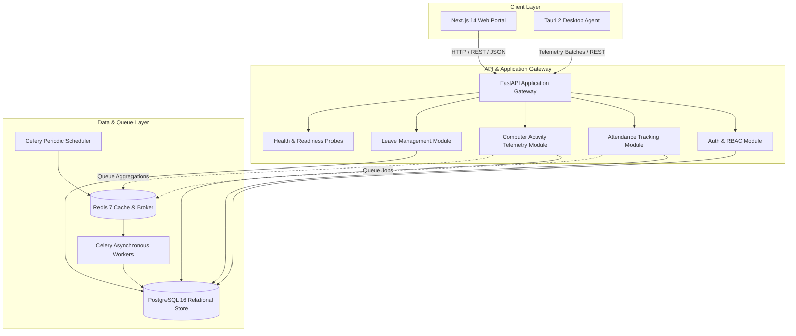

# System Architecture Specification

## Overview

The **Enterprise Employee Attendance, Computer Activity Tracking, and Leave Management Platform** is engineered as a high-performance **modular monolith** with clean separation across backend services, modern web interfaces, cross-platform native desktop agents, and containerized deployment infrastructure.

---

## 1. High-Level Architecture

---

## 2. Monorepo Structural Separation

The repository enforces strict architectural boundaries:

| Directory | Core Technologies | Primary Responsibility |
| :--- | :--- | :--- |
| `backend/` | Python 3.12, FastAPI, SQLAlchemy 2.0 Async, Alembic, Celery, Redis | Core business logic, data persistence, telemetry ingestion, and async task processing |
| `web/` | Next.js 14, React 18, TypeScript, TailwindCSS | Web dashboard for employees, managers, and administrators |
| `desktop/` | Tauri 2, Rust, React 18, TypeScript, Vite | Native background agent collecting active window titles, keystroke/mouse activity, and idle states |
| `infrastructure/` | Docker, Docker Compose, PostgreSQL 16, Redis 7 | Local development orchestration, multi-stage production container builds, and database initialization |
| `docs/` | Markdown, Mermaid | Comprehensive system specifications, schema models, and developer guides |

---

## 3. Core Domain Modules

### 3.1 Attendance Tracking Module
- Captures verified clock-in and clock-out timestamps with client IP and device signatures.
- Computes daily work durations and flags anomalous shifts.
- Provides daily summary calculations via asynchronous Celery tasks.

### 3.2 Computer Activity Telemetry Module
- High-frequency local event buffering on the desktop client (to eliminate overhead and network strain).
- Periodic batch synchronization (`/api/v1/activity/sync`) of active process names, window titles, active seconds, idle seconds, and interaction counters.
- Server-side indexing and aggregate calculation for manager dashboards.

### 3.3 Leave Management Module
- Handles requests for Annual, Sick, Casual, Maternity, Paternity, and Unpaid leave.
- Enforces state machine transitions: `PENDING` → `APPROVED` / `REJECTED` / `CANCELLED`.
- Manager approval hierarchies with role-based authorization.

### 3.4 Identity, RBAC & Security
- Standard OAuth2 password flow with JWT bearer tokens.
- Secure password hashing using Bcrypt.
- Role-based access control with granular roles: `ADMIN`, `MANAGER`, `EMPLOYEE`.

---

## 4. Resilience & Health Check Strategy

The backend exposes two specialized health verification probes:
1. **Liveness Probe** (`/api/v1/health`):
   - Fast, non-blocking check validating that the ASGI event loop and HTTP server are responsive.
2. **Readiness Probe** (`/api/v1/health/detailed`):
   - Deep inspection that executes `SELECT 1` on PostgreSQL, issues `PING` against Redis, and validates Celery broker connectivity. Returns HTTP 200 when ready or HTTP 503 if any critical dependency is offline.

