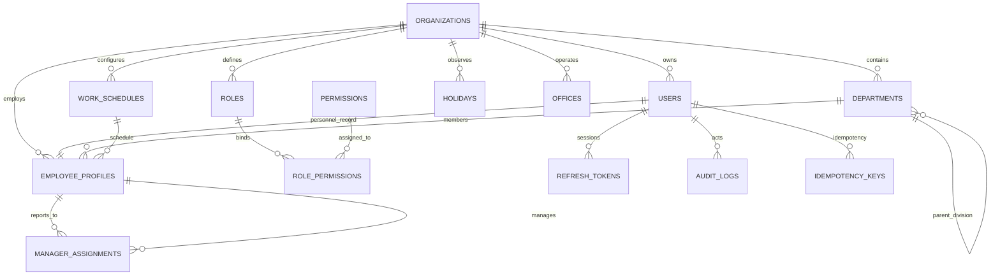
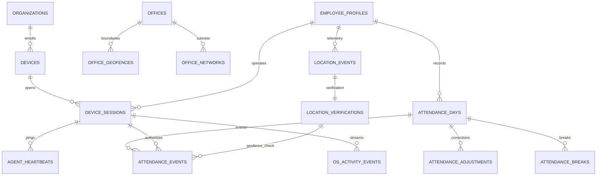
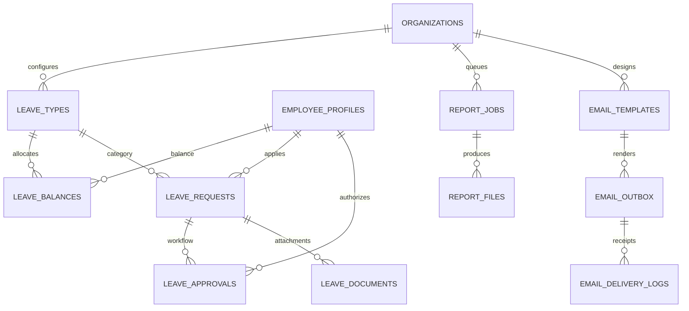

# Enterprise Database Architecture Documentation

## 1. Architectural Foundation & Specifications

- **Primary Database Engine**: PostgreSQL 16
- **ORM & Dialect**: SQLAlchemy 2.0 (Async driver: `asyncpg`, Sync/Migration driver: `psycopg2-binary`)
- **Migration Framework**: Alembic
- **Primary Keys**: UUID v4 across all 35 domain tables
- **Timestamps**: All timestamps stored with explicit timezone (`TIMESTAMPTZ` / `DateTime(timezone=True)`) using standard UTC
- **Multi-Tenancy**: Organization-level data isolation via `organization_id` foreign keys and composite unique constraints
- **Extensible Telemetry & Metadata**: Native PostgreSQL `JSONB` with indexed sub-attributes
- **Transaction Safety & Data Integrity**: Foreign keys with cascaded or restricted deletions, CheckConstraints, and composite UniqueConstraints

---

## 2. Complete Entity Catalog (35 Entities)

| # | Entity Name | Table Name | Domain Module | Primary Purpose |
| :- | :--- | :--- | :--- | :--- |
| 1 | **Organization** | `organizations` | Multi-Tenant Core | Top-level enterprise tenant boundary |
| 2 | **User** | `users` | Identity & RBAC | Corporate account credentials & authentication |
| 3 | **Role** | `roles` | Identity & RBAC | System and tenant-defined privilege groupings |
| 4 | **Permission** | `permissions` | Identity & RBAC | Granular atomic operation authorizations |
| - | **RolePermission** | `role_permissions` | Identity & RBAC | Junction table linking Roles to Permissions |
| 5 | **EmployeeProfile** | `employee_profiles` | HR & Personnel | Detailed employee personnel record & attributes |
| 6 | **Department** | `departments` | Organizational Hierarchy | Hierarchical organizational divisions |
| 7 | **ManagerAssignment** | `manager_assignments` | Organizational Hierarchy | Matrix & primary supervisor reporting relationships |
| 8 | **WorkSchedule** | `work_schedules` | Workforce Policies | Standard shift timings, flexible buffer & days |
| 9 | **Holiday** | `holidays` | Workforce Policies | Recognized statutory & optional company holidays |
| 10 | **Device** | `devices` | Device Management | Hardware fingerprints, OS details & enrollment |
| 11 | **DeviceSession** | `device_sessions` | Device Management | Active desktop agent connection lifecycles |
| 12 | **OSActivityEvent** | `os_activity_events` | Computer Activity | High-throughput window, process & input telemetry |
| 13 | **AgentHeartbeat** | `agent_heartbeats` | Computer Activity | CPU/memory telemetry, idle state & agent status |
| 14 | **AttendanceDay** | `attendance_days` | Attendance Tracking | Daily employee shift summary & roll-up stats |
| 15 | **AttendanceEvent** | `attendance_events` | Attendance Tracking | Atomic clock-in and clock-out timestamps |
| 16 | **AttendanceBreak** | `attendance_breaks` | Attendance Tracking | Lunch, coffee, personal & meeting shift pauses |
| 17 | **AttendanceAdjustment** | `attendance_adjustments` | Attendance Tracking | Correction workflows for missed shifts/clockings |
| 18 | **Office** | `offices` | Geofencing & Location | Corporate physical facilities & timezone roots |
| 19 | **OfficeGeofence** | `office_geofences` | Geofencing & Location | GPS coordinates & radius circular boundaries |
| 20 | **OfficeNetwork** | `office_networks` | Geofencing & Location | Whitelisted office IP addresses, CIDRs & BSSIDs |
| 21 | **LocationEvent** | `location_events` | Geofencing & Location | Raw GPS coordinates transmitted from devices |
| 22 | **LocationVerification**| `location_verifications` | Geofencing & Location | Geofence/network perimeter proximity evaluation |
| 23 | **LeaveType** | `leave_types` | Leave Management | Policy classification & annual allocation quotas |
| 24 | **LeaveBalance** | `leave_balances` | Leave Management | Per-employee annual leave ledgers & carryovers |
| 25 | **LeaveRequest** | `leave_requests` | Leave Management | Employee formal time-off applications |
| 26 | **LeaveApproval** | `leave_approvals` | Leave Management | Multi-tier managerial approval decisions |
| 27 | **LeaveDocument** | `leave_documents` | Leave Management | Uploaded medical notes & travel attachments |
| 28 | **ReportJob** | `report_jobs` | Reporting Engine | Asynchronous analytical batch computation requests|
| 29 | **ReportFile** | `report_files` | Reporting Engine | Rendered spreadsheets & documents in object store|
| 30 | **EmailTemplate** | `email_templates` | Communications | Jinja/HTML blueprints for transactional emails |
| 31 | **EmailOutbox** | `email_outbox` | Communications | Asynchronous transactional mail queue buffer |
| 32 | **EmailDeliveryLog** | `email_delivery_logs` | Communications | Webhook delivery receipts, opens & bounces |
| 33 | **AuditLog** | `audit_logs` | Audit & Compliance | Immutable security & state mutation logs |
| 34 | **RefreshToken** | `refresh_tokens` | Identity & RBAC | Cryptographically hashed refresh sessions |
| 35 | **IdempotencyKey** | `idempotency_keys` | API Reliability | Guarantees exactly-once mutated execution |

---

## 3. Entity-Relationship Diagrams

### 3.1 Tenant, Identity & Organization Structure

### 3.2 Attendance, Devices & Telemetry Pipeline

### 3.3 Leave Management, Reporting & Notifications

---

## 4. Key Constraints & Business Rules Matrix

| Target Table | Constraint Name | Type | Enforced Rule |
| :--- | :--- | :--- | :--- |
| `employee_profiles` | `uq_employee_code_per_org` | Unique | Employee codes must be strictly unique within an organization tenant |
| `employee_profiles` | `uq_employee_user_id` | Unique | 1:1 binding between corporate user identity and employee profile |
| `attendance_days` | `uq_attendance_day_per_emp_date` | Unique | Exactly one attendance day record per employee and work date |
| `os_activity_events` | `uq_device_session_event_id` | Unique | Device event IDs must be unique per session (deduplicating offline buffers) |
| `holidays` | `uq_holiday_org_date` | Unique | Prevents duplicate calendar holidays within an organization tenant |
| `roles` | `uq_role_org_name` | Unique | Prevents duplicate role names within an organization tenant |
| `leave_types` | `uq_leave_type_org_code` | Unique | Leave category codes (`ANNUAL`, `SICK`, etc.) unique per organization |
| `leave_balances` | `uq_leave_balance_emp_year` | Unique | One annual ledger per employee, leave type, and fiscal year |
| `leave_requests` | `chk_leave_dates` | Check | Start date must precede or equal end date (`end_date >= start_date`) |
| `idempotency_keys` | `uq_idempotency_key_org` | Unique | Idempotency keys must be unique per tenant organization |
| `email_templates` | `uq_email_template_org_key` | Unique | Template keys (`WELCOME`, `LEAVE_APPROVAL`, etc.) unique per organization |

---

## 5. Initial Seed Catalog

The database architecture includes an automated seeding module located at [backend/app/core/seeds.py](file:///c:/login%20and%20logout/backend/app/core/seeds.py).

### 5.1 System Roles
1. **Super Administrator**: Full unconstrained platform-level authority.
2. **Administrator**: Full tenant-level management control.
3. **HR Manager**: Personnel directory, leave allocation, attendance auditing, and reporting.
4. **Department Manager**: Team attendance approvals, shift correction reviews, team productivity monitoring.
5. **Team Lead**: Supervisor visibility into subordinate attendance and leave calendars.
6. **Employee**: Self-service shift clock-in/out, activity ingestion, personal leave requests.
7. **Compliance Auditor**: Read-only oversight across audit logs, attendance summaries, and compliance exports.

### 5.2 Granular Permissions Matrix
- **Auth & Users**: `auth:roles:read`, `auth:roles:write`, `auth:users:read`, `auth:users:write`
- **Employee Directory**: `employee:profiles:read`, `employee:profiles:write`, `employee:managers:manage`
- **Attendance**: `attendance:clock_in_out`, `attendance:view_own`, `attendance:view_team`, `attendance:view_all`, `attendance:adjust`, `attendance:approve`
- **Activity Telemetry**: `activity:telemetry:ingest`, `activity:telemetry:view_own`, `activity:telemetry:view_team`, `activity:telemetry:view_all`
- **Leave Management**: `leave:types:manage`, `leave:balances:manage`, `leave:requests:create`, `leave:requests:view_own`, `leave:requests:view_team`, `leave:requests:view_all`, `leave:requests:approve`
- **Offices & Geofencing**: `office:manage`, `office:geofence:manage`, `office:network:manage`
- **Devices & Security**: `devices:register`, `devices:manage`, `devices:block`
- **Reporting Engine**: `reports:generate`, `reports:view`, `reports:download`
- **Audit Trails**: `audit:view`, `audit:export`

### 5.3 Default Leave Types Template
- **Annual Leave** (`ANNUAL`): Paid = Yes, Allowance = 15 days, Max Carryover = 5 days.
- **Sick Leave** (`SICK`): Paid = Yes, Allowance = 10 days, Medical note required = Yes.
- **Casual Leave** (`CASUAL`): Paid = Yes, Allowance = 7 days, Max Carryover = 0 days.
- **Maternity Leave** (`MATERNITY`): Paid = Yes, Allowance = 180 days, Documentation required = Yes.
- **Paternity Leave** (`PATERNITY`): Paid = Yes, Allowance = 15 days, Documentation required = Yes.
- **Bereavement Leave** (`BEREAVEMENT`): Paid = Yes, Allowance = 5 days.
- **Unpaid Leave** (`UNPAID`): Paid = No, Allowance = 0 days.
- **Compensatory Off** (`COMP_OFF`): Paid = Yes, Earned overtime credit, Validity = 30 days.

---

## 6. Migration Execution & Rollback Verification

Alembic migrations are configured under [backend/alembic/versions/0001_complete_database_architecture.py](file:///c:/login%20and%20logout/backend/alembic/versions/0001_complete_database_architecture.py).

The migration suite has been automatically verified via [backend/tests/test_migrations.py](file:///c:/login%20and%20logout/backend/tests/test_migrations.py):
1. **Upgrade to Head**: Applies all 36 tables, indexes, and constraints cleanly.
2. **Downgrade to Base**: Drops all 36 tables in exact reverse topological order without foreign key collision.
3. **Re-Upgrade to Head**: Proves migration idempotency and clean re-execution.
